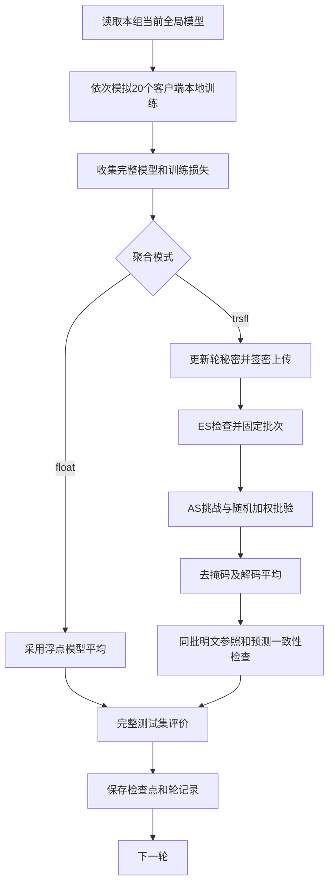

# TRS-FL 联邦学习每轮运行流程

本文结合实验方案与当前本地代码，说明实验初始化、每轮本地训练、两组聚合、协议验证、模型评价和结果提交的完整过程。

本文描述的是源码中的执行逻辑，不表示最新配置已完成协议测试或正式训练。本次仅生成文档，没有修改代码或操作服务器。

## 1. 当前实验配置

| 项目 | 配置 |
|---|---|
| 数据集 | MNIST |
| 模型 | CNN 或 MLP，代码默认 MLP |
| 数据分布 | IID 或标签排序双分片 Non-IID，代码默认 Non-IID；添加 `--iid` 选择 IID |
| 客户端数量 | 20 |
| ES 数量 | 2 |
| 每组客户端数量 | 10 |
| 秘密重构门限 | 3，与 ES 数量独立配置 |
| 每轮参与比例 | 100% |
| 全局聚合轮数 | 100 |
| 每客户端本地训练 | 3 个 epoch |
| 本地 batch size | 32 |
| 测试 batch size | 128 |
| 本地优化器 | SGD，学习率 0.01，动量 0.5 |
| 权重衰减、学习率调度 | 无 |
| 独立重复次数 | 1 |
| 起始训练种子 | 1，默认仅运行一次 |
| 对照组 | float、trsfl |
| 定点编码尺度 | 1,000,000 |
| 模型参数绝对值上限 | 100，超界拒绝，不裁剪 |
| 协议群 | secp256k1，Charm 曲线编号 714 |
| 批验随机系数 | 每客户端一个非零 128 位范围内的随机系数 |
| 签密时间戳有效窗口 | 3,600 秒 |

这里的“一轮”指一次全局模型更新。每个客户端先完成 3 个本地 epoch，所有客户端完成后进行一次全局聚合。

## 2. 整个任务的组织方式

入口为 [main_fed.py](F:/FL/federated-learning-master/main_fed.py)。默认 `--aggregation all --repeats 1 --seed 1`，执行顺序如下：

```text
训练种子 1，每组独立运行一次
  float：从初始模型训练 100 轮
  trsfl：重新从相同初始模型训练 100 轮
```

一个任务默认包含 1 次运行 × 2 组 × 100 轮，共 200 个全局轮次。两组分别训练，不把两组模型接成一条训练链。

同一任务内部，两组共享模型结构、初始权重、数据划分及每轮每客户端的训练随机安排，分别推进自己的全局模型。上一轮产生不同模型时，下一轮的本地训练输入也会不同。

`--seed` 控制训练随机安排，`--repeats` 控制独立重复次数，当前默认 1。协议密钥、组轮秘密和批验随机系数使用独立密码学随机源。原 `--seeds` 列表参数不使用。取消 quantized 独立训练组后，同批量化明文参照只作为内部检查保留，不单独训练或生成学习曲线。

## 3. 第一轮之前的初始化

### 3.1 数据、初始模型与配对资料

程序先校验参数、确定设备、加载数据，并检查实际图像形状。MNIST 训练集和测试集分别加载，训练集分给客户端，测试集用于评价。

在使用完整 60,000 个 MNIST 训练样本时：

- IID：随机打乱后等分，20 个客户端各获得 3,000 个样本。
- Non-IID：按标签排序，切成 40 个等大小数据片，每片 1,500 个样本；每客户端随机获得两个片，共 3,000 个样本。

每次重复保存初始模型、客户端样本索引、标签直方图及配对配置，使两组可以复用。已有资料与本次配置不一致时拒绝覆盖。划分必须等量、不重叠并完整覆盖训练集，不丢弃余数。

### 3.2 模型布局与协议对象

每个聚合模式启动时创建模型聚合适配器。适配器登记完整 `state_dict` 的参数名称、形状、类型及向量位置；布局顺序按参数名称排序，向量长度由实际模型决定。

只有 trsfl 组创建 TA、AS、ES 和 User 协议对象：

- TA 初始化群参数、主密钥和会话上下文，完成软件模拟的客户端注册。
- 20 个 User 持有各自长期私钥、注册身份和部分私钥等信息。
- AS 持有自身密钥及可信注册记录。
- 两个 ES 各持有自身密钥，分别管理编号 0～9、10～19 的客户端。
- 按每组 10 人、门限 3 生成 Asmuth–Bloom 秘密共享的公开模数参数。

长期注册状态和密钥在该次协议组运行的 100 轮中保留。每轮更新的是组秘密、份额、动态假名、临时密钥及轮密钥。新的独立重复会重新创建协议对象，产生新的协议秘密。

## 4. 每轮的实际执行顺序



图中展示主流程；实际代码还为各模式计算同批浮点与量化参照，用于范围检查及误差记录，具体见第 4.3 节。

### 4.1 所有客户端从同一个全局模型开始

每轮开始时，清空本轮模型列表和训练损失列表，然后依次处理 20 个客户端。每个客户端都复制本轮开始时的全局模型。

前一个客户端训练完成后的模型不会直接作为后一个客户端的起点。它们在模型更新关系上彼此独立，只有聚合时才汇总。

程序根据“本次训练种子、轮号、客户端编号”派生客户端本地训练种子，设置 Python、NumPy、Torch 等训练随机安排。数据加载器另使用独立生成器控制 minibatch 打乱，使协议随机调用不影响批次顺序。

### 4.2 客户端完成本地 SGD

本地训练由 [Update.py](F:/FL/federated-learning-master/models/Update.py) 中的 `LocalUpdate.train()` 执行：

1. 将模型设置为训练模式。
2. 为该客户端创建新的 SGD 优化器。
3. 在该客户端自己的样本上训练 3 个 epoch。
4. 每个 batch 依次执行清梯度、前向计算、交叉熵损失、反向传播和参数更新。
5. 返回完整 CPU `state_dict` 及按处理样本数加权的本地平均训练损失。

完整 MNIST 划分下，每客户端每轮的梯度更新次数为：

```text
ceil(3000 / 32) × 3 = 94 × 3 = 282 次
```

最后一个不足 32 个样本的 batch 仍参与训练，未丢弃。当前优化器每个客户端每轮重新创建，因此 SGD 动量状态不跨全局轮次保留。

默认日志显示客户端开始、每个本地 epoch 完成和客户端训练结束。所有客户端在单个进程中依次模拟。

### 4.3 收集完整模型并计算聚合参照

所有客户端完成后，将 20 份完整模型交给 [secure_aggregation.py](F:/FL/federated-learning-master/models/secure_aggregation.py) 中的 `ModelAggregator.aggregate()`。

适配器按登记布局展开每份完整模型，检查参数名称、形状、类型、维度和数值是否有效。编码规则为：

```text
z_i = rint(1,000,000 × w_i)
```

其中 `w_i` 是客户端完整模型向量，乘尺度时使用 float64，`rint` 使用最接近整数、正好居中时取偶数的舍入规则。签密前将整数逐坐标映射为模 q 的规范非负整数，负数也按该规则表示。

当前适配器在两种模式下都会构造：

- 同批本地参数的精确量化整数和、解码后的量化平均模型。
- 同批原始浮点模型的 FedAvg。

这些参照用于记录量化误差及检查正确性。即使是 float 模式，代码也会执行相同的编码范围检查；最终训练采用的仍是浮点 FedAvg 结果。

| 模式 | 本轮提交的模型 | 是否执行协议 |
|---|---|---|
| float | 原始浮点模型的 FedAvg | 否 |
| trsfl | 经完整协议恢复并通过检查的量化平均模型 | 是 |

float 完成上述聚合后进入第 4.9 节。以下第 4.4～4.8 节为 trsfl 专有流程。

### 4.4 生成组轮秘密并重构

`TRSFLProtocol.begin_round()` 调用 AS 的 `setup_group_secrets()`，为两个 ES 组分别生成新的 256 位秘密。

每组秘密通过 Asmuth–Bloom 算法产生 10 份份额。模拟中，每个客户端拿到自己的份额，再由程序提供同组另外两个不同份额，以达到门限 3 并重构本组秘密。程序检查重构结果与 AS 保存的秘密是否一致。

随后，每个 User 更新本轮承诺、动态假名和临时密钥，并结合组秘密、动态假名、与 AS 的共享值及轮次上下文派生自己的轮密钥。

每组客户端共享组秘密，但各自的轮密钥还绑定自身上下文。轮秘密、训练种子是两个不同概念，门限 3 也不表示需要 3 个 ES。

**实际调用顺序说明：**代码在所有客户端完成本地训练后、逐客户端编码上传前才调用 `begin_round()`。方案叙述可将轮秘密准备放在本轮训练之前；当前实现将其推迟，因为协议秘密不参与 SGD，仅用于该轮签密。每轮更新和上传前准备的要求仍保留。

### 4.5 对完整模型编码向量掩码并签密

适配器依次调用 `submit()`，将各客户端的规范模 q 编码向量交给对应 User。

User 根据轮密钥、会话、轮号、模型布局、动态假名和临时公钥上下文重现完整维度的 ChaCha20 掩码，逐坐标计算：

```text
C_i = (z_i + mask_i) mod q
```

随后构造包含客户端编号、ES 编号、轮号、动态假名、承诺、临时公钥、时间戳和完整密文的上传对象，生成 ES 认证标签及客户端签名。

认证与签名绑定完整密文摘要和规定元数据。哈希处理可以分块，但不截断模型向量。同一个客户端同一轮只允许签密一次，以防重用该轮掩码密钥和 nonce。

### 4.6 ES 检查并固定全员批次

每个 ES 的 `receive()` 检查：

- 上传是否属于当前轮，批次是否尚未固定。
- ES 归属、客户端成员身份及是否重复上传。
- 时间戳是否在有效窗口内。
- 临时公钥是否有效，认证标签是否匹配。

成功上传才进入 ES 的待聚合集合。每个 ES 收齐所属 10 人后，`edge_verify_aggregate()` 按客户端编号固定上传顺序，对模型密文逐坐标模 q 求和，并生成绑定上传内容、签名及聚合密文的批次摘要。

本实验要求全员参与；缺员时不生成可接受的有效批次。

### 4.7 AS 发出挑战，ES 返回加权签名

AS 的 `issue_challenge()` 接收两个固定批次，检查批次摘要、轮号、所属成员、时间戳、密文坐标，以及全部 20 个客户端是否完整且唯一。AS 还重新核对每个 ES 的密文聚合和是否等于其逐用户密文之和。

固定批次通过检查后，AS 为每个客户端独立生成一个非零随机批验系数。默认系数取值范围为 1 至 2^128−1。

每个 ES 按同一挑战中的系数计算加权签名和，通过 `weighted_response()` 返回。AS 再检查响应与固定批次是否对应。

随机系数只用于聚合签名验证。模型密文始终按普通求和聚合，不用这些系数对模型重新加权。

### 4.8 AS 批验、去掩码并恢复平均模型

AS 的 `unsigncrypt_aggregate()` 先确认挑战有效、两个 ES 响应完整，批次在挑战后未变化，然后执行随机加权聚合签名验证。

验证通过后，AS 根据自持的组秘密、注册记录和上传中的公开信息重现各客户端轮密钥及掩码，从总密文扣除全部掩码，返回模 q 的整数聚合和。

适配器按以下顺序解码：

1. 将模 q 聚合和提升为约定范围内的有符号整数和。
2. 检查聚合和是否在人数与编码界允许的范围内。
3. 除以编码尺度和实际参与人数。
4. 按原参数名称、形状和类型恢复完整模型。

当前配置下，每个坐标的平均为：

```text
平均参数 = 有符号整数聚合和 / (1,000,000 × 20)
```

代码不直接把有限域中的平均转成普通浮点参数。

恢复后，适配器检查协议整数和与同批量化明文整数和逐坐标相等，并检查恢复参数与量化参照逐参数相等。主循环随后在完整测试集上检查两个恢复模型的预测一致率是否为 100%。

这里的明文参照是针对该轮 trsfl 组自己的同一批本地模型额外计算的检查结果，不会形成独立量化训练轨迹，也不是 AS 正常解密所需的额外输入。

### 4.9 评价本轮候选全局模型

两组最终都将聚合结果加载到候选模型，在同一完整测试集上计算测试准确率和测试损失。评价使用 `eval()`，关闭梯度，不执行优化器更新。

- 测试准确率：正确预测数除以测试样本总数。
- 测试损失：交叉熵损失求和后除以测试样本总数。
- 本轮训练损失：20 个客户端各自本地训练平均损失的均值。

由于本实验各客户端样本数和本地 epoch 相同，这里的客户端损失平均与按处理样本数加权汇总一致。当前不额外计算训练集准确率。

### 4.10 保存模型并进入下一轮

完成检查和评价后，主循环：

1. 通过临时文件替换，更新 `last_good_model.pt`。
2. 若启用 `--save_round_models`，另外保存本轮模型。
3. 将聚合结果加载为下一轮全局模型。
4. 追加 `metrics.jsonl`，更新已提交轮号和状态。
5. 输出本轮准确率、损失和轮数。

平均模型直接作为下一轮的起点，不再对平均模型额外执行一次梯度更新。

## 5. 检查失败如何处理

以下情况会拒绝本轮结果：模型维度或类型不符、参数非有限或超界、整数和超界、缺员或重复上传、过期上传、认证标签错误、批次变化、聚合签名验证失败，以及整数和、恢复参数或预测一致性检查失败。

这些检查抛出异常后，程序不会继续使用失败模型推进下一轮，也不会通过静默减少参与客户端继续与全员明文组比较。

对于主循环捕获到的普通异常，程序在 `metrics.jsonl` 追加失败记录，写入 `failure.json` 和失败状态，记录轮号、客户端、所处阶段及原因，并终止任务。聚合检查或评价阶段失败时，先前成功保存的模型检查点仍保留。

人工 Ctrl+C 产生的 `KeyboardInterrupt` 不属于该 `except Exception` 捕获范围，可能留下最后一次写入的运行状态。不能仅根据旧 `status.json` 判断进程仍在运行。

## 6. 轮结束和任务结束的输出

| 输出 | 内容 |
|---|---|
| `train.log` | 使用启动命令中的 `tee` 保存的进度、指标和异常输出 |
| `paired/` | 本次重复的初始模型、数据索引、标签直方图和配对配置 |
| `config.json` | 本组配置、环境和代码指纹 |
| `model_layout.json` | 完整参数布局和编码约定 |
| `metrics.jsonl` | 每轮训练损失、测试指标及聚合诊断 |
| `status.json` | 最近写入的状态和已提交轮号 |
| `last_good_model.pt` | 最近保存的全局模型，初始化时对应第 0 轮 |
| `summary.json` | 完成该次该组全部轮次后的最终指标 |
| `failure.json` | 主循环捕获的普通异常详情 |

同一任务的 float 与 trsfl 两组完成后，程序生成最终指标表、trsfl−float 配对差值表、一致性表、统计 JSON 和两条准确率/损失曲线。默认 n=1，均值等于该次结果，不显示标准差阴影，样本标准差为 null，不能据此评价跨重复波动。

每轮记录的正确性诊断与独立组之间的最终模型差值应分别理解。量化误差可能改变后续模型轨迹；同批协议恢复一致，不等于已经证明所有场景下两组统计等效。

当前没有默认记录初始模型的第 0 轮测试指标，训练曲线从第 1 轮聚合后开始。未配置 `--target_accuracy` 时不统计达到指定准确率的轮次；当前主循环按指定全局轮数运行，不使用旧 `stopping_rounds` 参数自动早停。

## 7. 实现与方案的对应边界

1. **角色与网络。** TA、AS、ES、User 的职责和交互顺序保留，但均在单进程内模拟。模型下发、份额交换和签密上传由函数调用完成，未实现多机网络传输。注册中的 PUF 相关值为软件模拟秘密，不代表实体 PUF。
2. **轮秘密准备时机。** 代码先完成本地训练，再准备本轮协议状态并签密。秘密不进入 SGD，不影响本轮本地训练结果；每轮新生成和上传前可用的要求保留。
3. **门限重构。** 每组 10 人，门限 3。模拟为每个客户端直接提供足够的不同份额，不包含真实网络中的份额请求、超时、掉线或重入处理。
4. **AS 处理范围。** 固定批次包含逐用户上传，AS 会检查逐用户密文、重新核算聚合和及派生去掩码材料。不能将本实现描述为 AS 只接收一个组聚合向量，或据此推断通信和计算开销下降。
5. **明文检查参照。** 适配器为实验正确性检查计算同批明文参照；它不作为 AS 解签密所需的公开侧信道，不构成实际部署中的额外协议输入。
6. **验证状态。** 本文依据当前本地源码整理。新的 20 客户端、2 ES、100 轮、本地 3 epoch、batch size 32、1 次运行、两组对照配置尚未在本文工作中运行验证，不以旧服务器配置的结果替代新配置验证。

## 8. 对应代码与方案文档

- [联邦学习实验设计.md](F:/FL/联邦学习实验设计.md)：实验目标、两组对照及记录要求。
- [代码修改思路.md](F:/FL/代码修改思路.md)：接入接口、配置与实现调整。
- [utils/options.py](F:/FL/federated-learning-master/utils/options.py)：参数默认值。
- [main_fed.py](F:/FL/federated-learning-master/main_fed.py)：初始化、重复组织、逐轮训练、检查和提交。
- [models/Update.py](F:/FL/federated-learning-master/models/Update.py)：客户端本地 SGD。
- [models/secure_aggregation.py](F:/FL/federated-learning-master/models/secure_aggregation.py)：完整模型布局、编码和两种聚合路径。
- [TRS-FL.py](F:/FL/TRS-FL.py)：秘密共享、轮状态、签密、ES 检查和 AS 批验与恢复。
- [models/test.py](F:/FL/federated-learning-master/models/test.py)：测试指标与预测一致性。
- [utils/experiment.py](F:/FL/federated-learning-master/utils/experiment.py)：配对信息、随机安排与记录。
- [summarize_results.py](F:/FL/federated-learning-master/summarize_results.py)：跨重复结果汇总与绘图。
