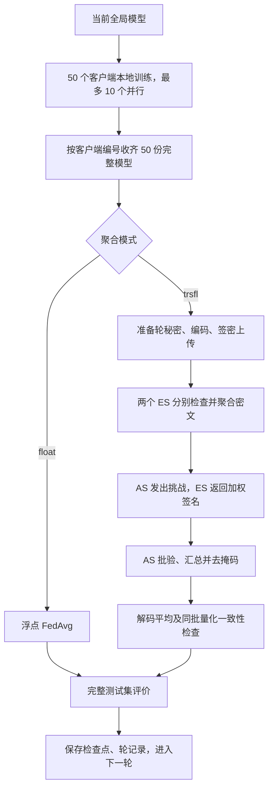

# TRS-FL 实验设计与运行流程

本说明合并原实验设计、代码接入思路、逐轮流程和并行实现记录，并按当前 50 客户端并行代码更新。配置与依赖见 [README](../README.md)，可复制命令见 [启动命令](../启动命令.md)。

## 1. 评价目标与对照关系

实验评价 TRS-FL 接入后对模型聚合、测试准确率、测试损失和收敛过程的影响。当前不安排计算/通信开销、客户端规模变化、掉线、重入或撤销实验。

MNIST-CNN 分别在 IID、Non-IID 数据分布下运行 float 与 trsfl 两组完整训练轨迹。`--aggregation all` 对每个训练种子先执行 float，再重新从相同初始模型执行 trsfl；每组默认 100 轮，共 200 次全局模型更新。

| 比较对象 | 能回答的问题 |
|---|---|
| float 与 trsfl 的完整训练轨迹 | 量化及方案接入后的总体模型效果差异 |
| 协议恢复结果与同批量化明文参照 | 相同本地输入下是否正确恢复量化聚合 |
| 同批量化平均与同批浮点平均 | 该轮同一输入上的量化误差 |

内部量化明文参照只用于检查，没有第三个独立训练组。因此，两组最终差值不能单独分离量化和协议对完整训练轨迹的影响。

## 2. 配对、数据划分与复现

同一种分布、同一训练种子下，两组共享模型结构、初始权重、样本划分、参与客户端及训练随机安排，各自推进自己的全局模型。由“训练种子、轮号、客户端编号”派生本地训练种子；数据加载器使用独立生成器控制样本打乱。协议密钥、组秘密和批验系数使用独立密码学随机源。

IID 对 60,000 个训练样本随机打乱后等分给 50 人，每人 1,200 张。Non-IID 对标签稳定排序后分成 100 片，每片 600 张，再随机分配给每人 2 片。样本等量、无重叠、完整覆盖。真实 MNIST 的类别数量不同，分片可能跨类别边界，不能把两个分片解释为严格两个类别。完整 10,000 张官方测试图片不参与 SGD。

初始模型、客户端索引和标签直方图保存在 `paired/`。已有配对配置与本次不一致时拒绝覆盖。IID 与 Non-IID 使用不同任务目录；不同配置的结果不得混作独立重复计算统计量。若需调参，应先从训练集固定划出验证集，并确保剩余训练数据可等量分配；正式对照不得对各组分别根据测试集调参。

## 3. 运行角色与并行边界

训练进程池使用 `spawn`，默认最多 10 个工作进程，每个进程一个 CPU 计算线程，并各自加载一次数据。空闲进程动态领取客户端任务；每种聚合模式的进程池跨轮复用。并发数与 ES 分组独立，不存在“同一批 10 个训练任务就是一个 ES 组”的对应关系。

主进程负责模型收集、全部密码学角色、聚合、评价和提交。TA、AS、ES、User 均通过进程内对象和函数调用模拟协议交互，没有多机网络传输。TA 注册使用的软件秘密不代表实体 PUF。

trsfl 初始化 50 个 User，ES 0 管理客户端 0–24，ES 1 管理客户端 25–49；每组门限为 3，门限与 ES 数量独立。长期注册信息及密钥在一次 trsfl 运行中保留，轮秘密、动态假名和轮密钥逐轮更新。

## 4. 每轮实际流程

### 4.1 本地训练与收集

每个客户端加载同一轮初全局模型，创建新的 SGD 优化器，在自己的数据上训练 3 个 epoch，返回完整 CPU `state_dict` 和按处理样本数加权的本地训练平均损失。前一个客户端的输出不会成为后一个客户端的训练起点。

每客户端每轮执行 `ceil(1200 / 32) × 3 = 114` 次参数更新。尾批保留，动量状态不跨全局轮次保存。主进程按客户端编号重排异步结果；收齐全部 50 人后才开始聚合，不按完成先后顺序累计浮点模型。

任一客户端失败时，记录客户端编号，取消尚未开始的任务，并拒绝本轮聚合。关闭进程池会等待正在执行的任务结束。日志包含并行开始、客户端完成提示及逐轮测试指标。

### 4.2 展开、编码与聚合参照

`ModelLayout` 按参数名称排序展开完整模型，登记名称、形状、类型及偏移。当前 MNIST CNN 参数维度为 21,840；不截断、补齐或用随机向量替代真实训练输出。当前适配器拒绝非浮点状态，扩展含整数 buffer 的模型时需另行设计策略。

定点编码采用 float64 乘尺度及最接近整数、居中取偶数的舍入：

\[
z_i=\operatorname{rint}(10^6 w_i),\qquad z_i\mapsto z_i\bmod q.
\]

参数非有限、绝对值超过 100、布局不一致或聚合整数范围不安全时拒绝继续，不静默裁剪、重缩放或减少参与人数。两种模式都计算同批浮点平均与量化整数和，用于范围检查和误差诊断；float 最终提交浮点 FedAvg，trsfl 提交协议恢复结果。

### 4.3 轮秘密、签密与上传

本地训练全部完成后，适配器调用 `begin_round()`。AS 为两个组分别生成本轮秘密并在本地留存，通过 Asmuth–Bloom 共享为每组产生 25 份份额。模拟为每个客户端提供自身及另外两个不同份额，达到门限 3 后重构组秘密。轮秘密不进入 SGD，因此代码在训练后、签密前准备它。

客户端更新动态假名、临时密钥和轮密钥，按会话、轮号及模型布局等上下文重现完整维度的 ChaCha20 掩码，并计算 `C_i = (z_i + mask_i) mod q`。上传对象包含编号、轮号、动态假名、承诺、临时公钥、时间戳、密文、认证标签与签名，不包含组秘密、秘密份额、轮密钥或私钥。同一客户端同一轮只能签密一次。

### 4.4 ES 分组聚合与 AS 全局恢复

各 ES 检查成员身份、分组、轮号、重复上传、时间戳、临时公钥和认证标签。`finalize()` 在全员上传后调用两个 ES 的 `edge_verify_aggregate()`，分别固定本组 25 人的批次并逐坐标模 q 累加密文。

AS 检查两个批次及全体 50 人的完整性、唯一性和聚合一致性，随后为各客户端生成非零随机批验系数。ES 按挑战返回加权签名，AS 检查并执行聚合签名验证。随机系数只用于验签，不对模型参数重新加权。

验证通过后，AS 汇总两个 ES 的密文和，利用自身留存的组秘密、AS 私钥、可信注册记录及上传公开上下文重现各客户端轮密钥，消除掩码，返回模 q 整数和。适配器先恢复有符号整数和，再执行实数平均：

\[
\bar w=\frac{\operatorname{SignedLift}(\sum_i z_i\bmod q)}{50\times10^6}.
\]

每个 ES 形成的是组密文和，不独立解密出组平均模型。当前实现先等待全部 SGD 完成，再顺序处理协议阶段，没有组完成即提前聚合的流水线。AS 批次仍包含逐用户上传，并重新核算密文和，不能描述为 AS 只接收两个向量或据此宣称总通信/计算开销下降。

### 4.5 一致性、评价与提交

trsfl 检查协议整数和与同批量化明文整数和完全相等、恢复参数逐项相等，并在完整测试集检查预测一致率为 100%。这些参照是实验核验材料，不是 AS 解密所需的额外明文输入。

候选全局模型以 `eval()`、无梯度方式评价：测试准确率为正确预测数占比，测试损失为全测试集交叉熵损失的样本平均。本轮训练损失为各客户端本地平均损失的均值；当前客户端样本数和本地 epoch 相同，不额外计算训练集准确率。

检查与评价成功后，原子替换 `last_good_model.pt`，将候选模型作为下一轮起点，再追加逐轮记录和更新状态。平均模型不额外执行一次梯度更新。默认只保留最近提交的模型；`--save_round_models` 可另存每轮模型，但当前没有自动断点续训入口。

普通异常会生成失败记录并终止任务，先前成功提交的检查点保留。Ctrl+C 的 `KeyboardInterrupt` 不属于 `except Exception`，可能留下旧的 running 状态，判断是否仍在运行须结合实际进程。

## 5. 指标与结论边界

| 字段 | 含义 |
|---|---|
| `test_accuracy`、`test_loss` | 当前组这一轮全局模型的测试指标 |
| `train_loss` | 本轮客户端本地训练平均损失 |
| `integer_sum_equal` | 协议恢复整数和与同批量化参照是否相等 |
| `parameter_max_abs_diff`、`parameter_mean_abs_diff` | 当前提交模型与同批量化参照的参数差 |
| `quantization_max_abs_diff`、`quantization_mean_abs_diff` | 同批量化平均与同批浮点平均的参数差 |
| `prediction_agreement` | trsfl 与同批量化参照的预测一致率，不是 float 与 trsfl 两条轨迹的预测一致率 |
| `consistency_passed` | trsfl 本轮一致性检查是否通过 |

签密掩码在正确恢复时消除；当前高精度定点编码可能只产生很小的单轮误差，故两条准确率与损失曲线接近符合设计目标。单轮同输入误差与两条独立训练轨迹在多轮后积累的参数差不同，应分别报告。

报告最终一轮指标、原始逐轮曲线、配对差值及一致性结果。最高准确率若另外展示，必须与最终值区分。配置 `--target_accuracy` 后记录首次达到目标的轮次；未配置或未达到时分别标记，当前不使用 `stopping_rounds` 自动早停，也不默认记录第 0 轮测试指标。

`--repeats 1` 对应每组一次独立运行，样本标准差为 null，不表示零波动。多次重复使用 `seed, seed+1, ...`，每次内部保持配对。曲线接近不等于统计等效，也不证明密码学安全性；不同模型、分布、人数或代码版本的结果不能直接合并外推。

## 6. 代码职责

| 文件 | 职责 |
|---|---|
| `main_fed.py` | 配置校验、任务组织、聚合评价和逐轮提交 |
| `utils/options.py`、`utils/datasets.py` | 参数及原始 MNIST/可选 Parquet 加载 |
| `utils/sampling.py`、`utils/experiment.py` | IID/Non-IID、配对存档与复现 |
| `utils/client_training.py`、`models/Update.py` | 进程池调度与本地 SGD |
| `models/secure_aggregation.py`、`models/Fed.py` | 模型布局、编码、聚合适配与浮点参照 |
| `TRS-FL.py` | TA、User、ES、AS 与逐轮签密接口 |
| `models/test.py`、`summarize_results.py` | 测试评价、汇总和局部放大绘图 |
| `test_parallel_training.py`、`test_noniid.py`、`server_checks.py` | 调度、划分、编码与完整协议边界检查 |

2026-10-21 本地 22 项检查通过，覆盖 Non-IID 配对、50 客户端小样本两轮 CPU 并行/串行一致性、默认路径及编码。当前 50 客户端配置尚未完成正式训练或完整密码学协议套件运行；服务器旧 20 客户端结果不替代该配置验证。历史结果位置与格式见 README。
